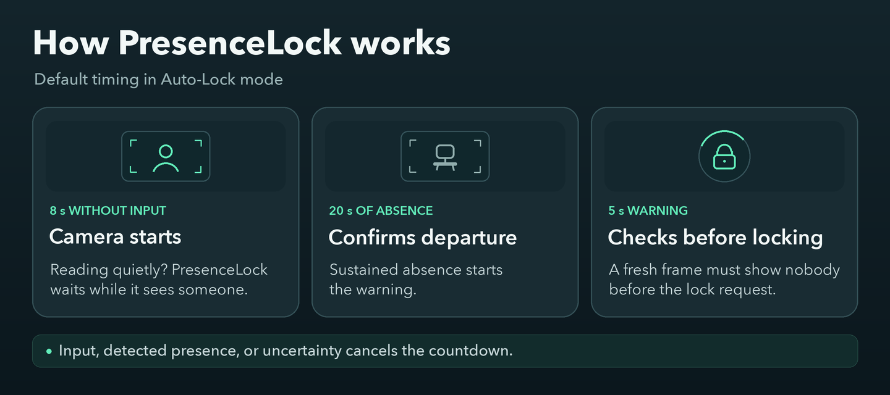
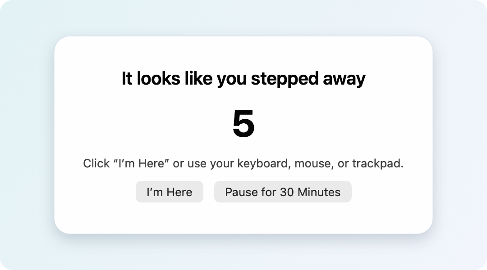

# PresenceLock


[Русский](README.ru.md) · [Download the beta](https://github.com/sylpht/PresenceLock/releases/tag/v0.2.8)

PresenceLock is a macOS menu bar app that uses the camera to distinguish stepping away from reading or watching the screen without touching the keyboard or mouse. It processes frames on your Mac and can ask macOS to lock the screen after a warning.

**Beta 0.2.8** requires macOS 14 or later. The downloadable build is for Apple silicon. Menus, settings, camera prompts, and reports are available in English and Russian. macOS selects the language from your app or system preferences. English is the fallback.



## Install and try

1. Download `PresenceLock-0.2.8.zip` and its `.sha256` file from [GitHub Releases](https://github.com/sylpht/PresenceLock/releases/tag/v0.2.8).
2. Unzip the archive, move `PresenceLock.app` to **Applications**, and open it.
3. Click the shield in the menu bar. Choose **Start Monitoring** and grant camera access. Use **Preview Camera…** to see what the camera detects.

You can verify the download by running `shasum -a 256 -c PresenceLock-0.2.8.zip.sha256` in the folder containing both files. The beta is ad hoc signed. If Gatekeeper asks for approval and you trust the download, macOS can offer **Open Anyway** under **System Settings → Privacy & Security** after you try to launch it. [Apple’s instructions](https://support.apple.com/en-us/102445)

To update, quit the previous version from its menu and replace the app in **Applications**. macOS may request camera permission again. The app stores statistics separately from the app bundle.

## How it works

- **Learning Mode** records quiet periods and predicted locks. Choose **Generate Report** to see likely presence, observed absence, and how different timings would have behaved.
- **Shadow Mode** checks your chosen timings on new observations while recording predicted locks.
- **Enable Auto-Lock…** turns on real lock requests for this app session. First set macOS to require a password immediately after the screen saver starts or the display turns off, then test the full walk-away and return flow on your Mac. [Apple’s password settings guide](https://support.apple.com/guide/mac-help/mchlp2270/mac)

By default, the camera starts after **8 seconds** without input. A **5-second** warning follows **20 seconds** of detected absence. A fresh frame must confirm absence at the end of the warning. Input, renewed presence, and uncertainty cancel the countdown. Use **Configure Timing…** to change the defaults.



The report compares an additional on-device Apple Vision pose check against the main detector during Learning and Shadow modes. The main detector drives real lock requests. Camera visibility, posture, and lighting affect detection. PresenceLock detects people in view. macOS handles authentication and unlocking.

## Privacy

Camera frames are processed in memory. The app stores only timing, coarse camera observations, decision events, and optional feedback in `~/Library/Application Support/PresenceLock`. Use **Open Data Folder** or **Delete All Data…** in the menu to manage them.

## Build from source

Use macOS 14 or later with Apple's developer tools and Swift 5.10 or later.

```sh
swift run --jobs 1 --scratch-path /tmp/presencelock-checks PresenceLockCoreChecks
./scripts/build-app.sh
```

The build script creates a verified ZIP and SHA-256 file in `build/` for the host Mac's architecture. See the [change history](CHANGELOG.md) for this release.
