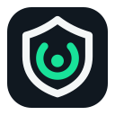

# PresenceLock



[English](README.md) · [Скачать бету](https://github.com/sylpht/PresenceLock/releases/tag/v0.2.8)

PresenceLock — утилита в строке меню macOS. Она учитывает присутствие у экрана, чтобы Mac мог блокироваться, когда вы отходите, и оставался доступным, пока вы читаете без клавиатуры и мыши. Камера и обработка изображения работают локально.

**Версия 0.2.8 · бета · macOS 14 Sonoma или новее.** Готовый архив собран для Mac с Apple Silicon.

Меню, настройки, запрос камеры и отчёты доступны на русском и английском. Язык выбирается по настройкам приложения и macOS. Если ни один из предпочитаемых языков не поддерживается, используется английский.

## Установка

1. В разделе **Releases** этого репозитория скачайте `PresenceLock-0.2.8.zip`.
2. Распакуйте архив, перенесите `PresenceLock.app` в папку **Программы** и откройте приложение. В строке меню появится щит.
3. В меню щита выберите **Начать мониторинг** и разрешите доступ к камере.
4. Проверьте ракурс через **Проверить камеру…**. В этом окне видео остаётся видимым во время работы с мышью и клавиатурой. После закрытия окна камера снова включается по таймеру бездействия.

Бета имеет локальную подпись и может вызвать предупреждение Gatekeeper. Если вы доверяете источнику архива, после первой попытки запуска откройте **Системные настройки → Конфиденциальность и безопасность → Всё равно открыть** и подтвердите запуск PresenceLock. Это исключение применяется к конкретному приложению. [Инструкция Apple](https://support.apple.com/ru-ru/102445)

Контрольная сумма поставляется рядом с архивом. Для проверки выполните команду в папке с обоими файлами.

```sh
shasum -a 256 -c PresenceLock-0.2.8.zip.sha256
```

При обновлении завершите работу старой версии через меню щита и замените приложение в **Программах**. Статистика хранится в отдельной папке. Из-за локальной подписи macOS может снова запросить доступ к камере.

## Как пользоваться

| Режим | Что происходит |
| --- | --- |
| **Режим обучения** | Собирает статистику пауз и записывает прогнозы блокировки. С него начинается каждый запуск приложения. |
| **Теневой режим** | Прогнозирует блокировку с выбранными порогами. Подходит для проверки порогов на новых наблюдениях. |
| **Боевая блокировка** | После предупреждения и повторной проверки кадра отправляет macOS запрос на блокировку. Включается вручную на текущий сеанс приложения. |

При обычной работе камера включается через **8 секунд** без ввода. После **20 секунд** подтверждаемого отсутствия появляется предупреждение на **5 секунд**. В конце приложение проверяет свежий кадр. Ввод, обнаруженное присутствие или неопределённые показания камеры прерывают отсчёт. Все три числа можно изменить через **Настроить пороги…**.

Дайте приложению понаблюдать за обычной работой и выберите **Сформировать отчёт**. В отчёте видны паузы, когда вы, вероятно, оставались у экрана, прогнозы блокировки и сравнение порогов. Длительность паузы считается от последнего ввода. Неясные эпизоды учитываются отдельно. Разметка добровольна. При желании отметьте конкретную ошибку через **Уточнить наблюдение**.

Если подбираете пороги, проверьте их в теневом режиме на новых наблюдениях. До включения боевого режима в настройках экрана блокировки macOS установите немедленный запрос пароля после заставки или выключения дисплея. Включив режим через меню щита, проверьте на своём Mac полный сценарий ухода и возврата. В журнале фиксируется ответ системы на запрос, а требование аутентификации видно на экране блокировки.

**Запускать при входе** добавляет приложение к объектам входа macOS. Если мониторинг был включён, он возобновится в режиме обучения. Изменение порогов в боевом режиме переключает приложение в теневой режим.

## Эксперимент с распознаванием позы

Apple Vision локально ищет признаки позы в части кадров, в которых основной детектор предполагает отсутствие человека. В обучении и теневом режиме результаты попадают в отчёт, где сравниваются прогнозы двух вариантов на одних и тех же записях. Реальные блокировки используют основной детектор. Модель поставляется в составе macOS.

## Конфиденциальность и ограничения

- Кадры обрабатываются на Mac в памяти. Журнал хранит только время, длительность пауз, сводные показания камеры, события алгоритма и необязательные отметки пользователя.
- Данные лежат в `~/Library/Application Support/PresenceLock`. В меню щита можно открыть эту папку или удалить все данные. При запуске приложение удаляет журналы старше 21 дня.
- Камера учитывает присутствие любого человека в кадре. Надёжность зависит от ракурса, освещения и положения человека. Разблокировку и проверку личности выполняет macOS.

## Сборка из исходников

Требуются macOS 14 или новее и инструменты разработчика Apple со Swift 5.10 или новее. Команды запускаются из корня проекта.

```sh
swift run --jobs 1 --scratch-path /tmp/presencelock-checks PresenceLockCoreChecks
./scripts/build-app.sh
```

Скрипт собирает приложение для архитектуры текущего Mac, применяет локальную подпись и записывает проверенный ZIP и его SHA-256 в `build/`. Для обычной установки загруженной сборки через Gatekeeper потребуются подпись Developer ID и нотарификация Apple.

См. [историю изменений](CHANGELOG.md).
